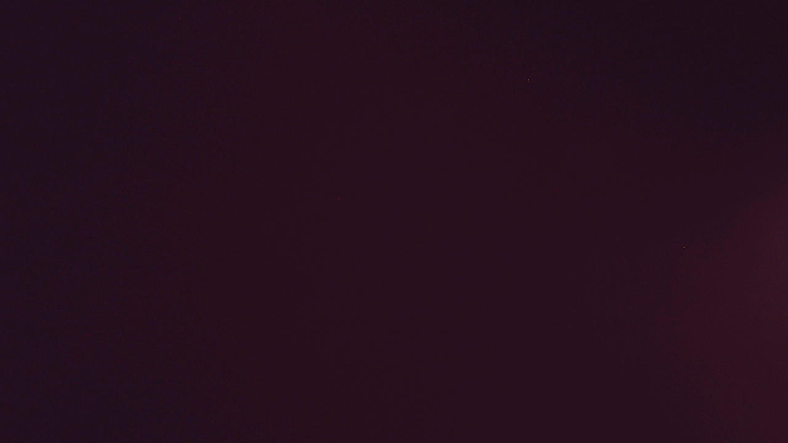
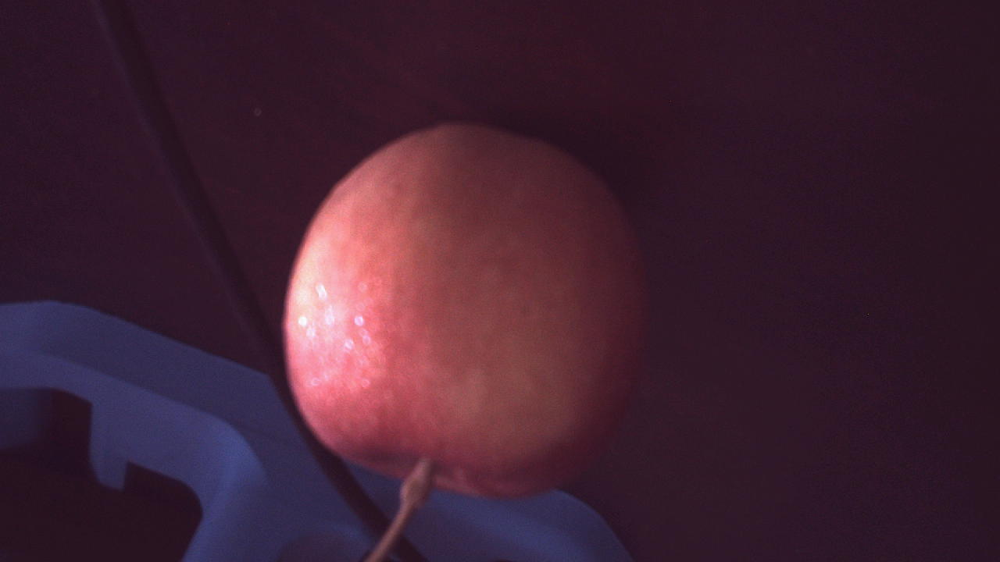
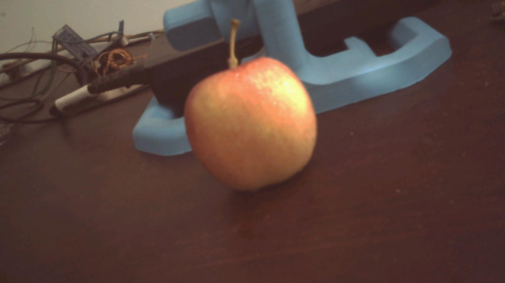

# ESP32-P4 Camera Streamer

Live MIPI-CSI camera video from an ESP32-P4 + Raspberry Pi Camera v2 (IMX219), compressed with the ESP32-P4's **hardware JPEG encoder** and streamed over **USB serial** — no Wi-Fi required. View it in a browser with zero installs, or in a Python/OpenCV window.

> There is currently no Arduino library or ready-made option for using a Raspberry Pi Camera v2 with the ESP32-P4 — this project fills that gap with a self-contained sketch, a custom IMX219 driver, and viewers you can use right away.



*A real frame streamed over USB at 720p, with ISP white balance and gain tuned for indoor lighting.*

### Before / after ISP tuning

Same scene, same firmware structure — the ISP tuning (white balance, gamma tone curve, denoise) applied:

| Before | After |
|---|---|
|  |  |
| Purple/magenta cast (B/G = 1.48), crushed blacks (median luma 33), heavy chroma noise | Neutral color (B/G = 0.89), natural exposure (median luma 58), denoised shadows |

## Features

- **Hardware JPEG encoding** on the ESP32-P4 — RGB565 frames from the V4L2 capture pipeline are compressed on-chip (quality 75, YUV422) before transmission over USB CDC serial at **2,000,000 baud**
- **Custom IMX219 sensor driver** included — registers the Raspberry Pi Camera v2 through Espressif's `esp_cam_sensor` detection API (the stock ESP32 Arduino core does not ship an IMX219 driver for the P4 CSI path)
- **ISP tuning from the sketch** — white balance gains, a gamma tone curve, Bayer denoising, analog gain and exposure are all set over V4L2 controls to kill the raw Bayer green cast, clean shadow noise, and brighten indoor shots
- **Two viewers included**:
  - `viewers/viewer.html` — Web Serial API, runs in Chrome/Edge with **no installation at all**
  - `viewers/viewer.py` — OpenCV desktop window with FPS overlay
- **Documented wire protocol** (14-byte `CAM0` frame header) so you can write your own viewer in any language

## Hardware

| Part | Notes |
|---|---|
| ESP32-P4 dev board with MIPI CSI connector | Tested on a WT9932P4-TINY-style pocket board |
| Raspberry Pi Camera Module **v2** (Sony **IMX219**) | Other sensors will not work without a matching driver |
| USB-C cable | data-capable; used for flashing *and* the video stream |

### Wiring

The camera connects to the board's MIPI CSI connector (data/clock lanes are dedicated P4 CSI pins, not GPIOs). Only the control lines are regular GPIOs:

| Camera control | ESP32-P4 GPIO | Defined in sketch as |
|---|---|---|
| CAM_EN (oscillator enable) | GPIO0 | `CAM_EN_PIN` |
| CAM_IO1 (reset) | GPIO1 | `CAM_IO1_PIN` |
| SCCB/I²C data | GPIO7 | `I2C_SDA_PIN` |
| SCCB/I²C clock | GPIO8 | `I2C_SCL_PIN` |

The IMX219 sits at SCCB address `0x10`. If your board routes these differently, change the four `#define`s at the top of `esp32p4_cam_test/esp32p4_cam_test.ino`.

## Software requirements

- **Arduino ESP32 core 3.3.12 or newer** (bundles the `ESP_Video` library and the P4 CSI/ISP stack)
- Board configuration used during testing:

  ```
  FQBN: esp32:esp32:esp32p4:ChipVariant=prev3,PSRAM=enabled,USBMode=hwcdc,CDCOnBoot=cdc
  ```

  > [!NOTE]
  > `ChipVariant=prev3` matches the silicon revision on my board. Pick the variant that matches yours in **Tools → Chip Version** if the build or boot behaves oddly.

## Getting started

### 1. Clone

```sh
git clone https://github.com/Munif-Khan/esp32-p4-cam-streamer.git
cd esp32-p4-cam-streamer
```

### 2. Build & flash (arduino-cli)

```sh
arduino-cli compile --fqbn esp32:esp32:esp32p4:ChipVariant=prev3,PSRAM=enabled,USBMode=hwcdc,CDCOnBoot=cdc esp32p4_cam_test
arduino-cli upload -p COM4 --fqbn esp32:esp32:esp32p4:ChipVariant=prev3,PSRAM=enabled,USBMode=hwcdc,CDCOnBoot=cdc esp32p4_cam_test
```

Or with the **Arduino IDE**: open `esp32p4_cam_test/esp32p4_cam_test.ino`, select **ESP32 Pico-P4** (or your board), set the options above under *Tools*, then upload.

> [!IMPORTANT]
> Keep the sketch folder named `esp32p4_cam_test` — Arduino requires the folder name to match the `.ino` file.

### 3. Watch the stream

**Option A — Browser (easiest):** double-click `viewers/viewer.html` to open it in **Chrome, Edge, or Opera**, click **Connect via USB Serial**, and pick the ESP32-P4's serial port. Nothing to install.

**Option B — Python/OpenCV:**

```sh
pip install pyserial opencv-python numpy
python viewers/viewer.py          # auto-detects the port
python viewers/viewer.py COM4     # or specify it
```

Press `q` or `Esc` in the window to quit. The stream is ~720p; resolution and FPS overlay are drawn on the frames.

## Stream protocol

Frames are sent over the 2 Mbaud serial link as packets with a 14-byte little-endian header followed by the payload:

| Offset | Type | Field | Value |
|---|---|---|---|
| 0 | `char[4]` | magic | `'C','A','M','0'` |
| 4 | `uint32` | length | payload size in bytes |
| 8 | `uint16` | width | image width |
| 10 | `uint16` | height | image height |
| 12 | `uint16` | format | `1` = RGB565, `2` = JPEG, `3` = GRAY8 |

The firmware currently emits `format = 2` (JPEG). Both viewers resynchronize on the magic bytes, so a partial read never permanently desyncs the stream.

## How it works

1. **Sensor bring-up** — `sensor_detect.c` implements Espressif's `esp_cam_sensor_detect_get_array()` hook, registering the IMX219 driver (`imx219.c`) with the `esp_cam_sensor` framework so the ESP_Video stack can probe the camera over SCCB. This is necessary because the precompiled ESP32-P4 Arduino libraries contain no IMX219 support.
2. **Capture** — the sketch opens `/dev/video0` (MIPI CSI) through the `ESP_Video` API and captures RGB565 frames.
3. **ISP tuning** — white balance gains (R=2.2, B=1.25) go in via the `V4L2_CID_USER_ESP_ISP_WB` control to remove the purple/green cast, a 16-point **gamma curve** lifts the crushed indoor midtones, and the **Bayer denoiser** (level 10) cleans the shadow noise that the lift would otherwise expose. Sensor analog gain (34 ≈ 7.1×) and exposure (1750 lines) are set manually at the sensor's ceiling.

   > [!NOTE]
   > The `esp_video_isp_pipeline_set_agc_status()` AGC pipeline was tested (with and without ISP AE statistics) and is **inert in this Arduino core build** — without manual gain/exposure the sensor falls back to its dark defaults. Manual control is therefore used.
4. **Encode** — each frame is compressed by the P4's **hardware JPEG encoder** into a 512 KB DMA buffer.
5. **Stream** — the `CAM0` header + JPEG payload are written to USB CDC serial.

### Tuning exposure and color

All in `esp32p4_cam_test/esp32p4_cam_test.ino`:

- `configure_isp_color()` — `red_gain` / `blue_gain` correct color casts (current: R=2.2, B=1.25; the stock-looking B=2.0 produced purple shadows)
- `configure_isp_gamma()` — tone curve; `kY[]` maps input→output levels. The hardware requires `x[0] > 0`, every X step a power of two, and `x[15] = 255`. Raise the mid entries for a brighter image, lower the low entries for deeper blacks
- `configure_isp_denoise()` — Bayer filter level 10 in `[2, 20]`; kernel taps must stay in `[0, 15]`
- `setSensorGain(34)` — analog gain index, range 0–41; lower for bright scenes to reduce noise
- `setSensorExposure(1750)` — exposure in lines; near the 1759-line frame maximum at 720p/15 FPS
- `image_quality = 75` — JPEG quality; raise for sharpness at the cost of USB bandwidth (~6 FPS at 90 vs ~15 FPS at 75)

## Repository layout

```
├── esp32p4_cam_test/          Arduino sketch (folder name must match .ino)
│   ├── esp32p4_cam_test.ino   capture → ISP tune → HW JPEG → serial stream
│   ├── sensor_detect.c        registers the IMX219 with esp_cam_sensor
│   └── imx219.*               IMX219 sensor driver
├── viewers/
│   ├── viewer.html            Web Serial browser viewer (zero install)
│   └── viewer.py              OpenCV desktop viewer
├── tools/
│   └── capture.py             grab a single frame from the stream (for tuning)
└── docs/                      sample frames + before/after tuning shots
```

## License

- Project code: [MIT](LICENSE)
- `esp32p4_cam_test/imx219*.c/h` and `sensor_detect.c`: **Apache-2.0** (derived from Espressif's `esp_cam_sensor` IMX driver work — see file headers)

## Acknowledgments

- Espressif for the ESP32-P4 `esp_cam_sensor` / `ESP_Video` stack and the Arduino ESP32 core
- The `esp_cam_sensor_imx` contributors, whose IMX219 driver made the Raspberry Pi Camera v2 work on the P4
